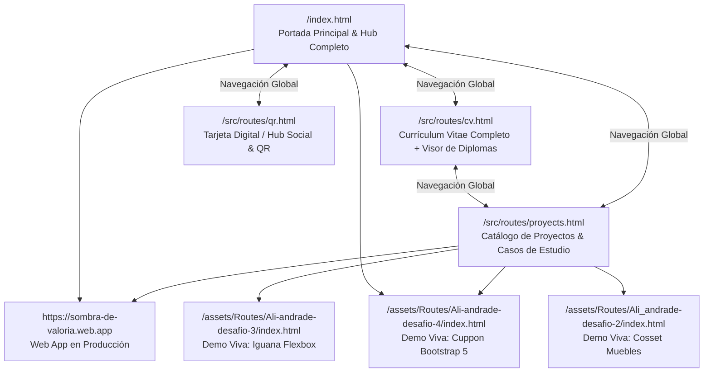

# Plan de Arquitectura de Información y Experiencia de Usuario (`ux-plan`)

## 1. Perfiles de Visitantes y Preguntas Clave que Deben Resolver

### Visitante Primario 1: Reclutador IT / Líder Técnico
- **Preguntas clave:**
  1. *¿Qué rol desempeña Ali y qué tecnologías domina realmente?* (Debe responderse en los primeros 5 segundos en el Hero).
  2. *¿Tiene proyectos reales que pueda ver funcionando y código que pueda inspeccionar?* (Acceso directo a *Sombra de Valoria* y a las demos Front-End sin toparse con tarjetas vacías).
  3. *¿Cuál es su formación oficial y su experiencia laboral previa?* (Acceso claro a su título de TSU en Informática, sus 7 certificados verificables y su trayectoria en sistemas y operaciones).
  4. *¿Cómo lo contacto o descargo/imprimo su CV rápidamente?* (CTAs de contacto a un clic y vista de CV optimizada para lectura e impresión).

### Visitante Primario 2: Cliente Potencial / Colaborador de Proyecto
- **Preguntas clave:**
  1. *¿Puede construir una interfaz moderna, rápida y adaptable a móviles?* (El propio portafolio actúa como demostración de calidad).
  2. *¿Cómo inicio una conversación rápida por WhatsApp o correo?* (Botones de acción directa con mensaje preconfigurado o copia de email con un clic).

---

## 2. Mapa del Sitio y Ecosistema de Rutas

Preservamos todas las rutas existentes del proyecto para garantizar compatibilidad total con enlaces compartidos previamente, pero las transformamos en un **ecosistema cohesivo y conectado**:

---

## 3. Flujo del Viaje de Usuario Principal (User Journey)

### En `index.html` (De "Tarjeta de Bienvenida Vacía" a "Portafolio Completo de Alto Impacto")
1. **Barra de Navegación Superior Persistente (`<header class="site-header">`):**
   - Marca personal (`Ali Andrade` + badge `Front-End & IT`), enlaces de ancla/página (`Inicio`, `Proyectos`, `Trayectoria`, `Certificaciones`, `CV Completo`, `Tarjeta QR`) y CTA destacado (`Contactar`).
   - En móvil: menú desplegable accesible con `aria-expanded` y cierre automático al navegar o pulsar `Escape`.
2. **Sección 1 — Hero de Posicionamiento Técnico:**
   - Titular claro, resumen de propuesta de valor (Desarrollo Web + Sistemas/IT), indicadores rápidos (TSU en Informática · +4 años en Soporte IT & Operaciones · 7 Certificaciones Oficiales 2023–2024), tarjeta de perfil con retrato real (`assets/img/ali_perfil.jpeg`) y avatar creativo opcional, más CTAs directos.
3. **Sección 2 — Proyecto Destacado (*Case Study*: Sombra de Valoria) + Proyectos de Ingeniería Front-End:**
   - Presentación amplia de **Sombra de Valoria** con captura real, contexto, reto, soluciones aplicadas y enlace a la aplicación en vivo.
   - Grilla de proyectos verificados (**Cuppon**, **Iguana Page**, **Cosset Muebles**) con filtros por tecnología (`Todos`, `JavaScript / Web App`, `Bootstrap / Responsive`, `CSS Flexbox / UI`) y botones hacia las demos funcionales alojadas en el repositorio.
4. **Sección 3 — Stack Técnico y Perfil Híbrido (Bento Grid):**
   - Organización visual clara en 3 bloques:
     1. **Front-End & UI:** HTML5, CSS3, JavaScript (ES6+), React, Angular, Bootstrap.
     2. **Back-End, Cloud & Sistemas:** Node.js, PHP, MySQL, MongoDB, Linux, Windows Azure, Git/GitHub, Ciberseguridad (`IFCT050PO`).
     3. **Operaciones, Redes & Herramientas:** ERP Defontana, PRTG Network Monitor, Soporte Técnico Hardware/Red, Micro-soldadura.
5. **Sección 4 — Resumen de Trayectoria y Educación + Vista Previa de Certificaciones:**
   - Línea de tiempo clara con sus etapas en **MEGA FRÍO Chile**, **Sociedad Bravo y Hermanos**, **Ministerio de Educación** y **TSU en Informática**, con enlace directo al CV detallado (`cv.html`).
   - Galería interactiva de sus **7 diplomas verificados** (SEPE y Desafío Latam) con apertura en modal accesible.
6. **Sección 5 — Contacto Directo sin Fricción + Footer:**
   - Tarjetas de acción directa: enviar correo, **copiar dirección de correo con confirmación instantánea**, abrir chat de WhatsApp, visitar GitHub, LinkedIn o abrir la Tarjeta QR (`qr.html`).

---

## 4. Mejoras Específicas en las Vistas Secundarias

### A. `src/routes/cv.html` (Currículum Vitae Interactivo + Imprimible)
- Incorpora la misma cabecera de navegación global para volver a `index.html` o ir a `proyects.html` en cualquier momento.
- Añade barra de utilidades del CV: botón **`Imprimir / Guardar PDF`** (`window.print()`), botón **`Ver Galería de Diplomas (7)`** y acceso directo a proyectos.
- Reestructura la experiencia laboral en una línea de tiempo cronológica limpia (corrigiendo los `
` anidados inválidos).
- Presenta las 7 certificaciones en tarjetas interactivas con su título real, entidad (SEPE / Desafío Latam), horas, código de verificación y botón para abrir tanto la imagen en alta resolución dentro del visor modal accesible como el documento PDF original cuando está disponible.
- Incluye hoja de estilos `@media print` para que, si un reclutador pulsa "Imprimir / Guardar como PDF", obtenga un CV limpio en fondo blanco sin modales ni barras flotantes.

### B. `src/routes/proyects.html` (Catálogo Completo de Proyectos y Laboratorio UI)
- Elimina por completo las 5 tarjetas placeholder con rutas rotas (`ruta/a/tu/imagen2.jpg`...`6.jpg`).
- Presenta:
  1. Caso de estudio extendido de **Sombra de Valoria** (`https://sombra-de-valoria.web.app`).
  2. **Cuppon — Plataforma de Cupones Responsiva** (`../../assets/Routes/Ali-andrade-desafio-4/index.html`).
  3. **Iguana Page — Maquetación Flexbox & Dark UI** (`../../assets/Routes/Ali-andrade-desafio-3/index.html`).
  4. **Cosset Muebles — Catálogo Web de Mueblería** (`../../assets/Routes/Ali_andrade-desafio-2/index.html`).
  5. **CV Semántico Inicial (Hito Fundacional HTML)** (`../../assets/Routes/Ali_andrade/curriculum vitale/index.html`).
  6. **Arquitectura de este Portafolio & Visor de Credenciales** (con enlace al repositorio GitHub).
- Añade filtros interactivos por tecnología y buscador instantáneo, además de un visor modal de vista previa rápida.

### C. `src/routes/qr.html` (Tarjeta de Contacto Rápido / Link-in-Bio & QR)
- Se transforma en una tarjeta digital profesional coherente con el sistema de diseño del portafolio, ideal para compartir en móvil o eventos de networking, incluyendo enlaces verificados a Portafolio, CV, GitHub, LinkedIn, WhatsApp, Correo y Facebook, más un código QR SVG nítido hacia `https://ali-ajelandrox.github.io/`.

---

## 5. Criterios de Aceptación UX y Accesibilidad

- [ ] **Skip Link:** Enlace `"Saltar al contenido principal"` visible al enfocar con teclado (`Tab`) en todas las páginas.
- [ ] **Cero callejones sin salida:** Todas las páginas principales (`index.html`, `cv.html`, `proyects.html`, `qr.html`) comparten la barra de navegación superior y el footer con enlaces cruzados.
- [ ] **Ergonomía móvil:** Ningún botón flotante (`.aside`) tapa el texto en viewports de `320px–768px`; áreas táctiles mínimas de `44x44px`.
- [ ] **Modales accesibles:** El visor de certificados se abre y cierra con teclado (`Escape`), bloquea el scroll del fondo mientras está activo, permite navegar entre los 7 certificados con botones Anterior/Siguiente o flechas del teclado y devuelve el foco al botón de origen al cerrarse.
